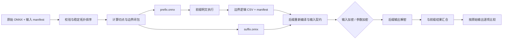

# 通用 ONNX 前缀明文与 FHE 后缀划分设计规范

状态：已实现；六任务 × 两种加密模式 GPU 验收通过，详见[验收报告](../report/onnx_split_gpu_lazy_acceptance.md)。

本规范定义一个通用的 ONNX 划分节点：读取原始推理 ONNX 和输入 CSV，按节点比例生成前缀/后缀模型；前缀使用明文执行，将后缀需要的全部边界张量保存为 CSV；后缀再进入现有输入加密或参数加密链路。

目标架构包括 CNN、MLP、Transformer 及带残差或分支的多输入/多输出网络。切分比例表示原始 ONNX 顶层计算节点的比例，不表示 FLOPs、参数量或运行时间比例。默认比例为 `0.9`，允许命令行显式覆盖。

## 1. 总体原则

1. 切分对象是原始 ONNX；切分比例、节点身份和边界名称都以原始图为准。
2. 前缀和后缀之间传递逻辑张量值。CSV 只保存 dtype、shape 和轴顺序对应的普通数值，不保存 skip、padding slot、CKKS level、scale 或密文布局。
3. 边界按真实数据依赖计算，不能假设图是串行链。残差旁路、分支、多输出和原输入直达后缀都必须保留。
4. 后缀作为新模型重新编译。每个边界张量的 Feature 类型和物理打包由其逻辑语义、后缀消费算子和最终编译契约确定，不能从 CSV 文件名或 rank 猜测。
5. 明文等价验证必须在编译和密钥生成之前完成；不支持的算子、控制流或输入布局必须提前失败。



## 2. ONNX 校验、节点排序与切点

### 2.1 使用的现成接口

实现脚本使用 ONNX 接口校验和提取模型，使用仓库已有依赖 NetworkX 排序：

```python
model = onnx.load(path, load_external_data=False)
onnx.checker.check_model(path)
onnx.utils.extract_model(
    input_path, output_path, input_names, output_names,
    check_model=True, infer_shapes=True,
)
```

- `onnx.checker.check_model(path)` 检查源模型结构和基本依赖；使用路径形式以支持 external data 和大模型，不自行重写 ONNX 合法性检查。
- `onnx.utils.extract_model` 按 tensor 名称提取依赖闭包，内置形状推断及源/目标模型校验，正常路径无需再单独调用 `infer_shapes` 或重复校验提取结果；大模型可能生成旁路 `.data` 文件。
- 自定义算子导致边界缺少 `ValueInfo` 时，优先复用已注册的 shape inference；仍缺失则依据显式绑定或明文执行结果，用 `onnx.helper.make_tensor_value_info` 补齐并校验，仅对该准备副本使用 `infer_shapes=False`。不能假定 ONNX 能推断所有自定义算子，也不自行重写通用形状推断；计数始终基于原始 `graph.node`。
- 拓扑排序使用 `networkx.lexicographical_topological_sort`，以原始 `graph.node` 下标作为唯一排序键，无需自行实现 Kahn 算法。普通 `topological_sort` 不显式指定本规范所需的 tie-break 规则。

本次核对环境为 ONNX `1.19.0`、NetworkX `3.4.2`。`extract_model` 不允许边界穿入控制流子图；其当前实现也不支持非空 `sparse_initializer` 和 `quantization_annotation`。第一版提前拒绝这些情况及未支持的控制流，不自行实现另一套提取器；后续升级依赖时复核限制。

### 2.2 稳定拓扑排序

切分脚本建立以下索引：

- `producer[tensor] = (node_index, output_index)`；按原始端口号枚举非空输出。
- 按原始端口号枚举输入；忽略可选空字符串。graph input 和 initializer 是外部数据源；其他输入通过 producer 索引连边。重复定义、缺失来源等合法性由源模型 checker 检查，不再实现独立校验器。

用原始下标构造 DAG，避免空节点名或重名影响节点身份：

```python
dag = nx.MultiDiGraph()
dag.add_nodes_from(range(len(model.graph.node)))  # 包括孤立节点和 Constant
for consumer, node in enumerate(model.graph.node):
    for port, tensor in enumerate(node.input):
        if tensor in producer:
            source, source_port = producer[tensor]
            dag.add_edge(source, consumer, key=port,
                         tensor=tensor, producer_port=source_port)
topo_indices = list(nx.lexicographical_topological_sort(dag, key=lambda i: i))
```

每个消费端口一条边：边 key 是 consumer 输入端口，属性保存 tensor 名和 producer 输出端口。`MultiDiGraph` 原生保留并行边，无需维护 `bindings` 列表或独立的节点消费者索引；消费者可从 `out_edges(..., keys=True, data=True)` 查询，外部输入的消费位置直接扫描原始节点输入。排序接口支持多重图；捕获 `NetworkXUnfeasible` 报错，无需再单独做环检测。

稳定规则是：**每一步在当前依赖已满足的节点中，优先选择原始下标最小的节点**。对同一原始图，结果不受建图插入顺序影响；不保证不同导出器产生相同顺序。manifest 同时记录原始下标和拓扑位置。源模型仍须通过 checker；此排序用于定义可重复的切点，不负责修复非法 ONNX。

### 2.3 节点计数和比例

默认 `count_policy = top_level_non_constant_v1`：

- 只计数顶层 `graph.node` 中 `op_type != "Constant"` 的节点。
- initializer 和 `Constant` 是静态数据源，不计入计算节点数，但按依赖复制到需要的一侧。
- 其他节点，包括 `Identity`、`Cast`、`Shape`、`Reshape`、`Flatten` 和自定义域节点，各计为一个原子计算节点；不在计数前做融合、消除、展开或编译器重写。
- `N` 为计数节点总数，`K = floor(Decimal(r) * N)`。`r` 使用命令行原始十进制字符串解析，避免二进制浮点误差。
- 要求 `0 < r < 1` 且 `1 <= K < N`。比例非法或导致空前缀/空后缀时失败，不自动修正。

直接过滤并切片拓扑序，无需另一套分区算法：

```python
compute = [i for i in topo_indices if model.graph.node[i].op_type != "Constant"]
N = len(compute)
K = int(Decimal(r) * N)  # 校验比例和非空约束后，正数取整即 floor
P, S = set(compute[:K]), set(compute[K:])
```

计数口径和取整是业务规则，NetworkX 不负责决定。`Constant` 留在 DAG 中参与依赖分析，但不属于 `P/S`，由模型提取接口按需保留。切点不能为了适配 FHE 编译器而静默移动；后缀无法编译时报告原因，调用者显式选择新的比例。

## 3. 边界闭包与模型生成

复用同一张 DAG，以 `nx.edge_boundary` 获取前缀到后缀的全部张量依赖：

```python
cut_edges = nx.edge_boundary(dag, P, S, data=True)
crossing = {
    attrs["tensor"]
    for _, _, attrs in cut_edges
}
```

多重边自动覆盖残差、多输出和重复消费端口，集合只对最终 CSV 输入去重。拓扑前缀保证不存在 `S → P` 依赖，无需再做一次反向扫描。graph input 和 initializer 不在节点 DAG 中，仍从 ONNX 输入索引处理。设 `I` 为原始 graph input，`O` 为原始 graph output：

```text
prefix_inputs  = {t ∈ I | t 被 P 中节点消费}
forwarded      = {t ∈ I | t 被 S 中节点消费}
prefix_outputs = crossing ∪ {t ∈ O | producer(t) ∈ P}
suffix_inputs  = crossing ∪ forwarded
suffix_outputs = {t ∈ O | producer(t) ∈ S}
```

规则如下：

- crossing 按 producer 的拓扑位置、输出端口排序；forwarded 按原始 graph input 顺序追加；所有集合按 tensor 名去重。
- 一个 crossing 被多个后缀节点或多个输入端口使用时，只生成一个逻辑输入，manifest 记录全部 consumer 位置。
- 前缀最终输出、后缀最终输出、原输入直接作为输出的情况都要记录 `output_routes`，最终汇合必须恢复原始输出顺序。
- initializer 和 Constant 输出按静态依赖保留，不作为 crossing CSV。原始输出若直接来自输入或静态源，也必须记录相应 route。
- 使用 `onnx.utils.extract_model` 按 `prefix_inputs/prefix_outputs` 和 `suffix_inputs/suffix_outputs` 提取两侧模型：从目标输出反向收集依赖，遇到指定输入即停止；必要的 initializer、Constant、opset、value_info、函数和 external data 随模型保留。动态张量不能物化为 initializer。它不完整保留源模型元数据；需要的 `metadata_props` 用 `onnx.helper.set_model_props` 显式写入，语义信息同时记录在 manifest 中。
- prefix 输出至少包括 crossing 和 prefix 负责的原始输出；suffix 输入至少包括 crossing 和 forwarded。不能只取切点最后一个节点的一个输出。
- 复用提取接口的 checker，另核对切分专有的接口名称、dtype、shape、producer/consumer 映射和模型 hash；若之后修改模型，则重新校验。

已核对现成接口的职责边界：`lexicographical_topological_sort` 负责稳定排序，`edge_boundary` 负责跨区依赖，`extract_model` 负责按输入/输出闭包生成 ONNX。不能再用 `nx.ancestors` 或 `dag.subgraph` 替代模型提取：前者不会在边界输入处停止，后者不生成 ONNX 接口，也不保留 initializer、ValueInfo 和 external data。

剩余的 producer/consumer 端口索引、graph input/initializer 识别、比例计数、边界 CSV、manifest 和 packing contract 属于 ONNX 语义或本项目业务规则，没有对应的通用公开接口，必须保留为薄适配层。不要依赖 `onnx.utils.Extractor` 的私有成员来进一步压缩实现。提取后核对两侧计算节点分别来自 `P/S`；未连接所需输出的死节点可由 `extract_model` 裁掉，应记录实际节点数，不回调比例；没有后缀输出时明确报错。

`split_manifest.json` 至少包含：

```json
{
  "schema_version": "onnx_split_v1",
  "source": {"path": "model.onnx", "sha256": "..."},
  "split": {
    "ratio_text": "0.9",
    "count_policy": "top_level_non_constant_v1",
    "node_count": 100,
    "prefix_count": 90,
    "topology": "networkx_lexicographical_original_index"
  },
  "models": {"prefix": "prefix.onnx", "suffix": "suffix.onnx"},
  "inputs": [],
  "output_routes": []
}
```

真实 manifest 还要保存每个边界 tensor 的原始名称、稳定 ID、producer/consumer 端口、dtype、shape、轴语义和 CSV 路径；示例中的空数组不能作为运行时接口。

## 4. 前缀明文执行与 CSV

### 4.1 输入与执行

输入 manifest 为每个原始输入声明：名称、CSV、dtype、完整 shape、轴顺序和 C-order 展平规则。单输入模型可以用 `--input-csv` 便捷传入，但 shape 和语义仍必须能从 ONNX 唯一确定；多输入使用命名绑定，禁止按字典顺序猜测。

前缀执行统一使用：

```text
execute(model, feeds_by_name, requested_outputs, semantic_context)
```

BERT/ViT 使用项目已有明文参考实现 `tools/evaluate_transformer_onnx_csv.py`，其 NumPy `float64` 语义是这两个模型的唯一明文验收基准；完整原图基准直接调用该实现读取原始 CSV。执行器支持命名的多输入和指定 crossing/suffix 输出。其他模型使用 `tools/evaluate_onnx_csv.py` 的 ONNX Runtime 与多项式适配；未知算子、未支持控制流和动态数据依赖提前失败。原图输入保留声明的 dtype；BERT 的有效 token 长度沿用现有 attention mask 约定，ViT 动态 batch 由输入 manifest 显式绑定。

### 4.2 边界 CSV 格式

- 每个逻辑 tensor 一个无表头 CSV；数值按 ONNX 轴顺序 C-order 展平。
- CSV 不包含 `output,index,value` 比较表头，也不包含物理 padding 或密文 slot。
- manifest 保存 dtype、shape、元素数、轴顺序、CSV hash 和执行样本 hash；写出后重新读取并逐项核对。
- 浮点值使用可往返的十进制格式；NaN、Inf、非法数字、元素数量不一致和 shape 不一致均失败。
- `[1,C,H,W]` 保持 batch 维，不能因为 batch 为 1 就改成 `[C,H,W]`；动态维必须由显式 shape binding 解析，不能用元素总数猜测。

prepare 阶段必须运行完整原图和 prefix，比较每个 crossing；再用回读的边界 CSV 运行 suffix，与 prefix 已完成的输出汇合，比较原图全部输出。只有结构检查、CSV 往返和明文等价全部通过，才发布样本 manifest。

## 5. 后缀输入的语义与打包

### 5.1 语义先于物理布局

边界 CSV 的打包方式不是由“这是前缀输出”或 CSV 文件名决定，而由以下信息唯一确定：

1. ONNX dtype 和完整 shape；
2. 原图 producer 的轴变换；
3. suffix 消费者的输入端口语义；
4. 显式 boundary hint（当 shape 不能唯一确定语义时）。

推荐的逻辑类别：

| 逻辑形状/轴语义 | FHE Feature 候选 |
| --- | --- |
| `[N,C,H,W]` NCHW 空间激活 | Feature2D |
| `[N,C,L]` NCL 序列/一维卷积激活 | Feature1D |
| `[N,F]` 单样本向量或 MLP 特征 | Feature0D |
| `[N,T,D]` token 矩阵或明确的 `[M,N]` 矩阵 | FeatureMat |
| Shape/axes/indices 等控制张量 | 静态控制量，不进入 CKKS Feature |

相同 rank 和元素数量不能决定语义。例如 `[1,64,128]` 可能是 NCL，也可能是 NTD；`[64,128]` 可能是向量批次，也可能是矩阵。若候选不唯一，要求 boundary hint 指定轴和语义；若不同 consumer 需要互不兼容的表示，直接失败或插入已有且可验证的转换层，不能静默复制 CSV 并改解释。

### 5.2 重新编译与生成 packing contract

suffix 作为新模型重新编译。编译阶段为每个逻辑输入生成 `input_contract.json`，至少包含：

- 逻辑 tensor ID 与 compiler feature ID 的映射；
- representation、dim、channel/shape、轴到 Feature 的映射；
- `pack_style`、`mat_pack_style`、skip、invalid_fill、pack_num、block/interleaving；
- FeatureMat 的 head shape、n_heads、matmul block size 和转置规则；
- CKKS 参数 hash、输入 level、编码 scale、padding/有效区域和数值缩放约定；
- suffix/manifest/config 的 hash。

输入加密的 Client 和参数加密的 Runner 都必须读取同一逻辑 manifest，并按各自编译产物的 contract 编码；不能各自根据 CSV rank 猜打包。物理打包只在 contract 中定义，边界 CSV 永远保持逻辑值。

0D、1D、2D、FeatureMat 混合输入只有在编译器、Client、Runner 三者都支持且 contract 可逐项验证时才允许。缺少 shape、轴、head 或不支持的布局组合必须在编译/图生成前失败。

## 6. 通用链路与验收

入口如下：

```bash
python tools/prepare_split_onnx.py \
  --onnx model.onnx --ratio 0.9 \
  --inputs-manifest inputs.json --output-dir split/

python training/run_compile.py \
  --input split/suffix.onnx \
  --split-manifest split/split_manifest.json \
  --output output/ --style multiplexed

# 生成计算图（参数加密模式还需既有 provision 步骤）后：
python tools/run_split_inference.py --task-dir output/task --output-dir result/
```

两种加密模式共用 `suffix.onnx`、边界 CSV 和逻辑 manifest；参数加密额外使用现有 storage-aware config、provision 和解密流程。最终汇合工具按 `output_routes` 恢复原始全部输出，不允许漏掉前缀已完成的输出或残差旁路。

### 6.1 六个任务的 GPU lazy 验收

以下六个 `runs/` 任务必须在默认切分比例 `0.9` 下完成同一套 prefix/suffix 验收。各任务继续使用其 `run_pipeline.md` 的默认 PN15Default 配置，不新增参数名或显式参数开关。

| 任务 | 原始 ONNX | 原始 CSV 输入 |
| --- | --- | --- |
| BERT | `runs/BERT/model/trained_poly.onnx` | `runs/BERT/input.csv` |
| cifar10 | `runs/cifar10/model/trained_poly.onnx` | `runs/cifar10/img.csv` |
| imagenet | `runs/imagenet/model/trained_poly.onnx` | `runs/imagenet/img.csv` |
| retina | `runs/retina/model/epoch041.onnx` | `input_0=img.csv`、`input_1=non_inv.csv`、`input_2=inv.csv` |
| ViT | `runs/ViT/model/trained_poly.onnx` | `runs/ViT/patch_input.csv` |
| yolov5 | `runs/yolov5/model/best_conv_outputs.onnx` | `runs/yolov5/img.csv` |

每个任务均执行以下两个 suffix GPU 流程：

1. **输入加密 GPU lazy**：prefix 使用任务规定的明文参考执行，写出全部 crossing CSV；suffix 以这些 CSV 为逻辑输入，按现有输入加密 GPU lazy 流程编译、推理并解密。
2. **参数加密 GPU runtime_lazy**：使用同一 suffix、同一 crossing CSV 和同一逻辑 manifest，按现有参数加密、provision 和 GPU `runtime_lazy` 流程推理，再解密 suffix 输出。

两种流程共用相同的切分 manifest 和边界 CSV，各自生成实际编译产物的输入 contract；加密模式可能改变物理 level，不能混用 contract。BERT/ViT prefix 沿用既有 NumPy `float64` 参考语义。

验收基准固定为**原始完整 ONNX 文件直接接收原始 CSV 输入的明文结果**，不是 prefix 输出、suffix 明文结果或 FHE 中间结果。对每种模式：

1. 保存原始完整模型的全部输出及其名称、shape、dtype。
2. 解密 suffix 输出，按 `output_routes` 与 prefix 已完成的输出汇合，恢复原始输出顺序。
3. 对每个原始输出逐元素计算 `abs(fhe_value - original_plaintext_value)`，取所有输出、样本和元素的最大值：

   ```text
   max_abs_error = max(abs(fhe_output - original_full_onnx_output))
   ```

4. 只有 `max_abs_error < 0.1` 且没有输出缺失、名称错配、shape/dtype 不一致、NaN 或 Inf 时，输入加密和参数加密两种模式才分别通过。`0.1` 为严格小于关系，等于 `0.1` 也失败。

每个任务至少保存以下证据：split manifest、prefix/suffix 模型及 hash、所有 crossing CSV 及 hash、原始完整模型明文输出、两种模式的 GPU lazy 日志和 metrics、suffix 解密输出、逐输出比较报告及最终 `max_abs_error`。报告必须标注 `reference = original_full_onnx_csv_plaintext`、加密模式、参数配置和 suffix hash，确保不能误把 prefix/suffix 明文对比结果当作 FHE 验收结果。

必须验证：

1. 原始 ONNX、prefix、suffix 均通过 checker；模型和 external data hash 一致。
2. 稳定拓扑顺序、切点、节点分区、边界集合和 output route 可重复生成。
3. 前缀 crossing 与 suffix 明文结果逐张量等价；CSV 写读不改变 dtype、shape 和元素顺序。
4. Client/Runner 的输入集合、名称、shape、contract、signature 和 CKKS 上下文逐项一致。
5. 六个任务的输入加密 GPU lazy 和参数加密 GPU `runtime_lazy` 均完成，且每种模式的 `max_abs_error < 0.1`；最终结果比较原始模型全部输出，FHE 误差和明文切分误差分开记录。

测试至少覆盖：串行 CNN、残差 CNN、MLP、Transformer 多输入、多输出、并行分支、二维/三维 token、不同切点、空节点名、Constant/initializer 依赖、external data、shape 歧义和不支持控制流。CIFAR10 只是回归样例，不是本规范的模型范围。

实现完成的判据是：不修改脚本即可对支持范围内的 CNN/MLP/Transformer 生成可核验的 prefix/suffix 和全部边界 CSV；下游不需要人工为每个 CSV 选择打包方式；歧义或不支持情况在加密前明确失败；输入加密和参数加密均按最终 contract 完成验证。

当前实现由 `prepare_split_onnx.py` 负责切分及明文等价验证，`onnx_split_contract.py` 负责接口/布局/hash 校验，`run_split_inference.py` 调用现有 GPU Client/Runner、解密并汇合输出。六任务的完整命令保存在各自 `runs/*/run_pipeline.md`；不支持的混合 FeatureMat/空间布局、非浮点控制边界和 batch > 1 在编译前失败，其他语义歧义要求显式 boundary hint。
